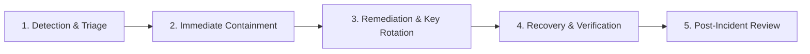

# TTC NETWORK — Security Incident Response & Recovery Runbook
**Document ID:** `SEC-IR-006`  
**Date:** October 25, 2026  
**Status:** ACTIVE OPERATIONAL RUNBOOK  
**Target:** `ttc-network`  

---

## 1. Incident Classification & Severity Levels

| Severity | Definition | Examples | SLA Response Time |
| :---: | :--- | :--- | :---: |
| **SEV-1 (Critical)** | Active compromise of administrative credentials, database unauthorized mass modification, secret leakage, or platform outage. | Firebase Admin key exposed; unauthenticated privilege escalation exploited; database wiped. | **Immediate (< 15 mins)** |
| **SEV-2 (High)** | Confirmed unauthorized access to user PII, storage data tampering, or unauthorized mass push notification spam. | Student phone number database scraped; malicious push notifications broadcast to users. | **< 1 hour** |
| **SEV-3 (Medium)** | Exploitation of limited endpoints without data loss (e.g., link preview DoS, spam submissions, isolated user account compromise). | Link preview scraper memory spike; localized account takeover without elevated privilege. | **< 4 hours** |
| **SEV-4 (Low)** | Minor security bugs, low-risk misconfigurations, non-exploitable dependency alerts. | Minor CSP violation; outdated development dependency. | **< 24 hours** |

---

## 2. Emergency Incident Response Phases



### Phase 1: Detection & Triage
1. **Identify the Scope:**
   - Review Google Cloud Console / Firebase Authentication logs for suspicious token issuance or new admin account creations.
   - Check Firestore usage metrics and Cloudflare R2 / Cloudinary transfer logs.
   - Inspect Vercel deployment logs for anomalous 500 errors or high-frequency invocations of `/api/**`.
2. **Assign Incident Lead:**
   - The Principal Security Engineer leads containment and coordination.

### Phase 2: Immediate Containment
1. **Revoke Suspect Sessions:**
   - In Firebase Console $\rightarrow$ Authentication $\rightarrow$ Users $\rightarrow$ Revoke tokens for compromised accounts.
   - Clear session cookies globally by temporarily rotating the `SESSION_SECRET` in Vercel.
2. **Lock Compromised Endpoints:**
   - If an API route is under active attack (e.g. `/api/send-push`), toggle emergency maintenance mode or deploy a hotfix restricting the route to administrators immediately.
3. **Database Emergency Lockdown:**
   - If `firestore.rules` are being exploited, deploy emergency restrictive rules:
     ```bash
     npx firebase deploy --only firestore:rules
     ```

### Phase 3: Credential Rotation Protocols

If a credential or private key is suspected of being compromised, execute the following rotation procedures in order:

#### 1. Firebase Admin SDK Private Key Rotation
1. Go to **Google Cloud Console** $\rightarrow$ **IAM & Admin** $\rightarrow$ **Service Accounts**.
2. Select the service account used by TTC Network (`firebase-adminsdk-...`).
3. Click **Keys** $\rightarrow$ **Add Key** $\rightarrow$ **Create new key (JSON)**.
4. Base64-encode or extract the new private key and client email.
5. In **Vercel Project Settings** $\rightarrow$ **Environment Variables**:
   - Update `FIREBASE_ADMIN_PRIVATE_KEY` and `FIREBASE_ADMIN_CLIENT_EMAIL`.
6. Redeploy the application.
7. Return to Google Cloud Console and **Delete** the old, compromised key.

#### 2. Cloudflare R2 Storage API Key Rotation
1. Log into **Cloudflare Dashboard** $\rightarrow$ **R2 Object Storage** $\rightarrow$ **Manage R2 API Tokens**.
2. Create a new API token with Read & Write access to `ttc-network` buckets.
3. Update `R2_ACCESS_KEY_ID` and `R2_SECRET_ACCESS_KEY` in Vercel environment variables.
4. Update `STUDY_R2_ACCESS_KEY_ID` and `STUDY_R2_SECRET_ACCESS_KEY` if distinct.
5. Trigger a production redeployment in Vercel.
6. Revoke the old API token in Cloudflare dashboard.

#### 3. Cloudinary API Secret Rotation
1. Log into **Cloudinary Console** $\rightarrow$ **Settings** $\rightarrow$ **Access Keys**.
2. Generate a new API Key & Secret.
3. Update `CLOUDINARY_API_KEY` and `CLOUDINARY_API_SECRET` in Vercel.
4. Redeploy Vercel production.
5. Disable the old key pair.

#### 4. SMTP / Email Password Rotation
1. Log into the Google Account for `process.env.SMTP_EMAIL`.
2. Navigate to **Manage your Google Account** $\rightarrow$ **Security** $\rightarrow$ **2-Step Verification** $\rightarrow$ **App Passwords**.
3. Delete the existing App Password.
4. Generate a new App Password named `TTC Network Production`.
5. Update `SMTP_PASSWORD` in Vercel environment variables and redeploy.

---

## 3. Data Integrity & Recovery Verification

1. **Firestore Point-in-Time Recovery (PITR):**
   - If Firestore documents were maliciously altered or purged, initiate a restore using Google Cloud Firestore backups:
     ```bash
     gcloud firestore databases restore --source-backup=projects/PROJECT_ID/locations/LOCATION/backups/BACKUP_ID
     ```
2. **Storage Blob Verification:**
   - Inspect Cloudflare R2 bucket audit logs to verify that no unauthorized bucket policy or deletion events occurred.
3. **Audit User Roles:**
   - Run a diagnostic query across `/users` to confirm that only authorized personnel have `role == 'admin'` or `role == 'super_manager'`:
     ```typescript
     const adminUsers = await adminDb.collection("users").where("role", "in", ["admin", "super_manager"]).get();
     adminUsers.docs.forEach(doc => console.log(doc.id, doc.data().displayName, doc.data().email));
     ```

---

## 4. Post-Incident Review & Blameless Post-Mortem

Within 48 hours of resolving any SEV-1 or SEV-2 incident:
1. Conduct a blameless post-mortem covering:
   - Root cause analysis (5 Whys).
   - Detection timeline and response duration.
   - Effectiveness of containment procedures.
   - Permanent preventive controls implemented.
2. Archive the incident log in `docs/security/incidents/` with redacted sensitive details.
